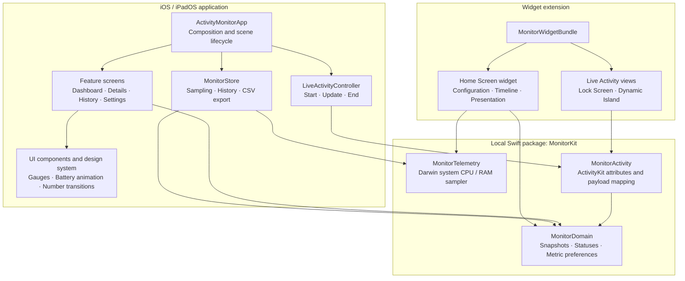

# Activity Monitor

Native SwiftUI iPhone / iPad app, iOS 17+, with an ActivityKit Live Activity extension. Bundle identifier: `com.invivo.ios.Activity-Monitor`. No watchOS target.

## Open / build

Open `ActivityMonitor.xcodeproj` in Xcode and choose the `ActivityMonitor` scheme. For a physical device, select your development team for both app and extension. The project is generated from `project.yml` with XcodeGen (`xcodegen generate`). No third-party runtime dependencies.

## Design and animation

`Resource/UI_set_preview.png` is the visual reference. The original Battery / Hardware / Network palette, black background, dividers, half-dials and circular network dials are preserved. `Sources/Resources/BatterySequences` contains original exported PNG frames: three 360-frame loops and three 31-frame fill entrances, played at 30 fps with bounded decoded-image caching. Original phone graphics and app icon are in the asset catalog.

## Measurement scope

The dashboard and History use **System CPU** and **System RAM used (estimate)**. System CPU is the non-idle share of aggregate Darwin host CPU tick changes between samples; **100% means all logical cores combined**, on a 0–100% scale. The first sample needs a baseline before a rate can be shown. System RAM used is estimated as physical RAM minus `HOST_VM_INFO64.free_count × pageSize`. Apple's kernel includes speculative pages in `free_count`, so they are not subtracted a second time. This estimate includes non-free cache/reclaimable allocations; it is not a memory-pressure score or the sum of app footprints. [Apple XNU host statistics](https://github.com/apple-oss-distributions/xnu/blob/main/osfmk/kern/host.c)

Details retains separate **App CPU** (100% means one logical core; multicore use can exceed 100%) and **App memory footprint** readings. Public Darwin host APIs may fail or return system-cached/rate-limited statistics; missing or invalid readings remain unavailable rather than borrowing the app values. A Simulator's host statistics describe the Mac running it, not a physical iPhone. Simulator builds/screenshots establish integration and rendering only. [host_statistics64](https://developer.apple.com/documentation/kernel/1502863-host_statistics64)

Battery/charging status, Low Power Mode, thermal state with a four-level thermometer (no inferred °C reading), disk capacity, active network path and interface traffic counters also use system APIs. The dashboard shows exact Charging / Full / Unplugged / Unavailable battery states and a storage-used dial with available / total capacity. Network traffic is an interface measurement, not an internet bandwidth test or carrier billing total.

In Settings → Live Activity data, select one to three items: Battery, System CPU, System RAM, Network, Temperature or Storage. Numbered selections indicate display order; compact Dynamic Island uses the first item. Changes persist on device and immediately refresh an active Live Activity. Storage percentage is always shown in the compact Island and snapshot caption; detailed storage byte fields are included only while that item is selected; legacy content defaults to Battery / System CPU / Network.

Sampling pauses in the background. Live Activity displays the latest foreground system CPU/RAM sample, battery/thermal/interface values, its timestamp and storage-used percentage on the Lock Screen and Dynamic Island. The Pause label is hidden; the timestamp still identifies the last measurement. Foreground Live Activity writes are throttled to approximately 10 seconds; this app does not schedule periodic background Live Activity refreshes. System fields are separate optional payload values; older content without them shows unavailable, with no app-value fallback. iOS controls Live Activity refresh and animations; it does not allow the app's continuously running 30 fps battery animation there. No background execution workaround or fabricated readings are used.

CSV export is initiated by the user and omits disk space readings because Apple's display-only required-reason API declaration forbids sending those values off-device. No analytics, tracking, server or cloud account is required.

## Home Screen widget

Add Activity Monitor from the Home Screen widget gallery. Long-press each widget and choose Edit Widget to select Battery, Temperature, Storage or System RAM independently. The first item is required; the second and third can be None. Small shows the first item; medium and large show up to three unique selections. Widgets retain the black background, green battery, orange thermal section, purple storage and yellow RAM instruments, with static liquid graphics appropriate to WidgetKit.

The extension samples the device independently when iOS grants runtime. It requests a refresh after 30 minutes (approximately 48 requests/day); iOS can delay it according to visibility and budget. Every size shows the original sample time, and a fallback timeline entry marks that same sample stale after one hour. Opening the app or choosing Refresh now requests another widget timeline; the two-second foreground timer does not. System RAM uses a one-shot host occupancy estimate (including caches) only when selected. CPU and interface rates remain Live Activity options; no two-sample CPU polling loop or app-process substitution is added to Home Screen widgets. Gallery data is an example; installed widgets use system readings.

## Languages

English, Traditional Chinese, Simplified Chinese, Japanese; follows the device's preferred app language.

## References

- [System Status](https://techet.net/sysstat/): battery, storage, hardware and historical graph feature reference.
- [ActivityKit](https://developer.apple.com/documentation/activitykit): app and extension lifecycle.
- [Displaying live data with Live Activities](https://developer.apple.com/documentation/activitykit/displaying-live-data-with-live-activities): system-rendered updates and animations.
- [Required reason APIs](https://developer.apple.com/documentation/bundleresources/app-privacy-configuration/nsprivacyaccessedapitypes/nsprivacyaccessedapitypereasons): privacy declarations.

See `Docs/PLAN.md` and `Validation/REPORT.md` for implementation checklist and actual validation evidence.

## Modular development

Arrows show composition or module usage. App services own foreground sampling and Live Activity updates; the Home Screen widget samples independently when iOS grants runtime. Shared package modules contain no view or scene lifecycle logic.

The application and widget share a local Swift package with `MonitorDomain`, `MonitorTelemetry` and `MonitorActivity` products. Feature screens, reusable instruments and app lifecycle services are separated. See [Architecture](Docs/ARCHITECTURE.md) for module boundaries and data flow.

After cloning, install XcodeGen (`brew install xcodegen`), run `xcodegen generate`, then open `ActivityMonitor.xcodeproj` and select the ActivityMonitor scheme. Select your development team before deploying to a physical device. The local package is included in this repository and requires no external package download.
